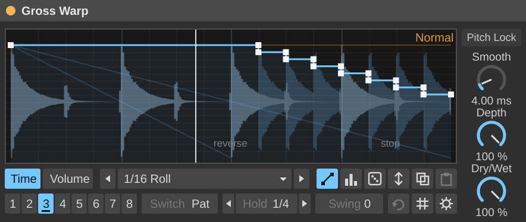

# Ableton Plugins

Max for Live devices for Ableton Live.

| Device | What it does | Download |
|---|---|---|
| [**Gross Warp**](gross-warp/) | Gross Beat-style time and volume envelopes locked to the song: half time, tape stops, stutters, rolls, scratches, reverses and gates. Eight patterns, 1 beat to 4 bars, any meter, Hold, Swing, Dice/Evolve, 76 presets + combos, pitch lock, and a companion MIDI device to play patterns from notes. | [GrossWarp.zip](https://github.com/Skizos/ableton-plugs/raw/main/gross-warp/dist/GrossWarp.zip) |



## Installing a device

You need **Live 12 Suite**, or Live 12 Standard with the Max for Live add-on.

1. Download the device's zip and unzip it: you get one folder.
2. Put that folder where Live can see it — either:
   - move it into your **User Library**: macOS `~/Music/Ableton/User Library/`,
     Windows `C:\Users\<you>\Documents\Ableton\User Library\` (*Live → Settings → Library* shows where yours is); **or**
   - in Live's browser click **Add Folder…** under *Places* and pick the folder.
3. In Live's browser open that folder and drag the device onto a track.

Keep each folder's files together (a device may load scripts from its own folder). Each device's README has the
details: [Gross Warp](gross-warp/README.md).

## Development

Each device is a self-contained folder: sources in `src/`, a Node build that writes the `.amxd` files and the zip into
`dist/` (committed, so the download links work), and tests that run without Max:

```
cd gross-warp
npm test              # the device's tests
npm run build         # rebuild dist/ after changing src/
```

CI runs every device's tests on each push and pull request. [CLAUDE.md](CLAUDE.md) has the rules the devices are built
by (gen~ codebox, Max JavaScript, Live API and parameter conventions).
